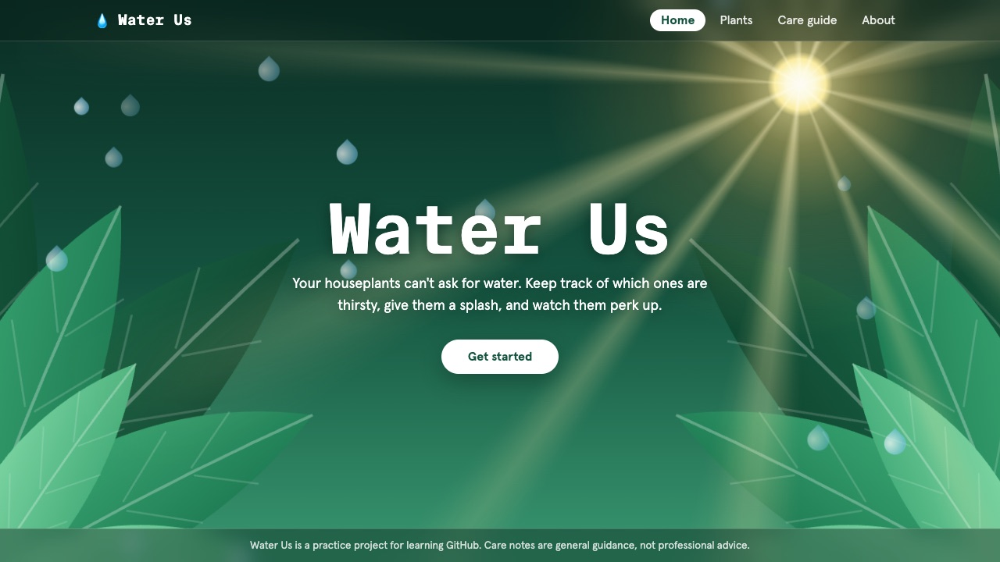
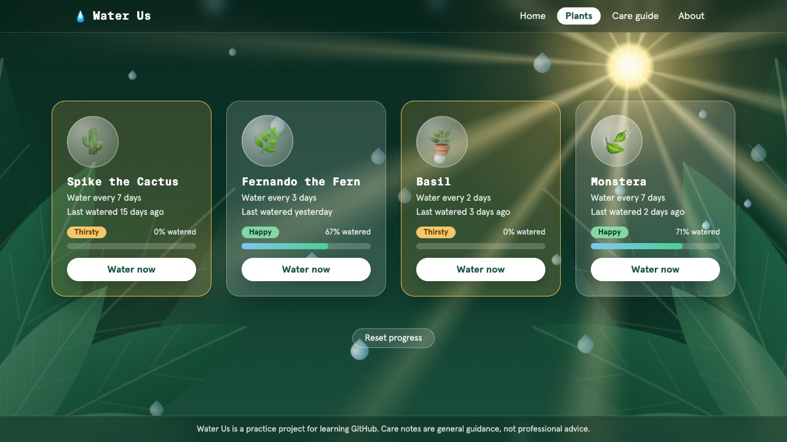
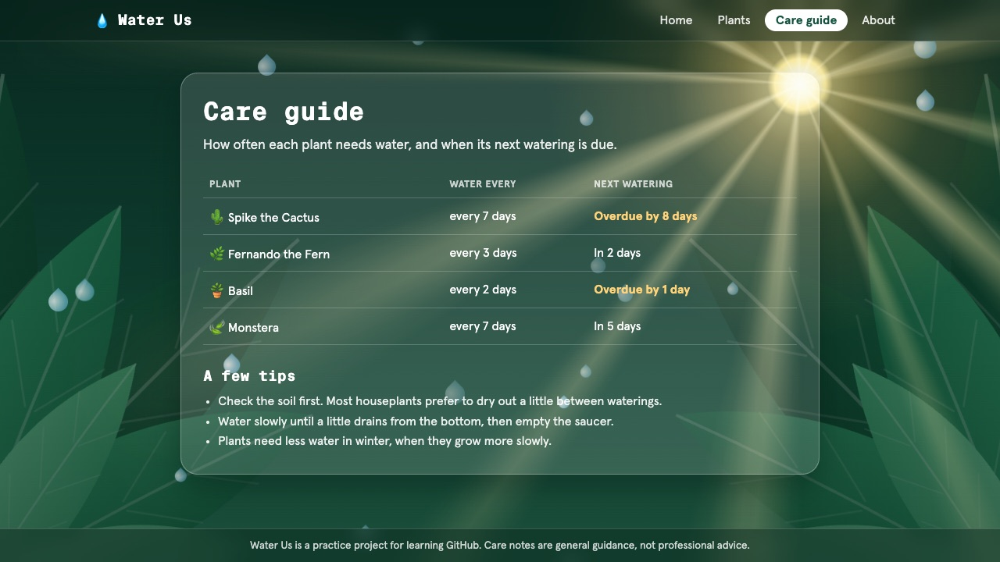
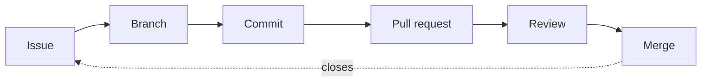
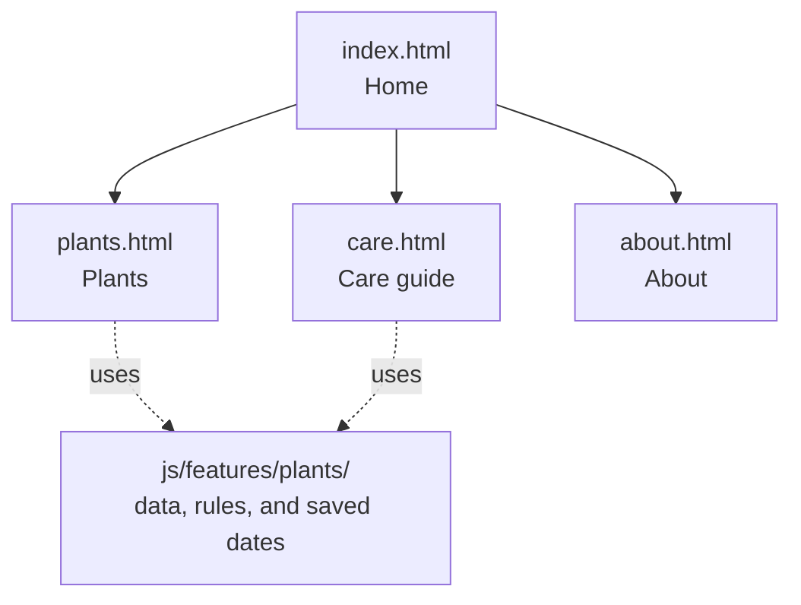

  

  A simple website that tells you which houseplants need watering. 
  Built with plain HTML, CSS, and JavaScript.

## Preview

| Home | Plants | Care guide |
|:-:|:-:|:-:|
|  |  |  |

Press **Water now** and the rain falls, the plant perks up, and the day is saved in your browser. Plants get thirsty again as real days pass.

## Get started

1. **Fork this repository.** Untick **Copy the main branch only**, so that you get every branch.
2. **Turn on Issues** in your fork: **Settings → General → Features → Issues**.
3. **Turn on GitHub Pages** to see your changes live: **Settings → Pages**, then set **Source** to **Deploy from a branch** and choose `main` and `/ (root)`.
4. Follow along with the course.

> [!IMPORTANT]
> When you open a pull request, set the **base repository** to **your fork**, not to this repository.

## How a change travels

## Site map

Every page is styled by `css/styles.css`, and every page shows the same leafy backdrop with the sun and the falling rain.

## Care guide

The care guide is the source of truth for how often each plant needs water.

| Plant | Water every |
|-------|-------------|
| Spike the Cactus | 14 days |
| Fernando the Fern | 3 days |
| Basil | 2 days |
| Aloe Vera | 10 days |
| Monstera | 7 days |

## What is inside

Open the repository tour

| Path | What it contains |
|------|------------------|
| [`index.html`](index.html), [`plants.html`](plants.html), [`care.html`](care.html), [`about.html`](about.html) | The four pages |
| [`css/`](css) | The styles, one file for each part of the site |
| [`js/`](js) | The code. Plants, their rules, and saving the dates are in `js/features/plants/`. The list of plants is in [`plants.js`](js/features/plants/data/plants.js) |
| [`images/`](images) | The banner, the background artwork, and the preview pictures above |
| [`favicon.svg`](favicon.svg) | The icon in the browser tab |
| [`tests/`](tests) and [`scripts/`](scripts) | Optional checks you can run with Node: `node --test` and `node scripts/check-plants.mjs` |
| [`CONTRIBUTING.md`](CONTRIBUTING.md) | How changes are made in this project |

To preview the site on your own computer, run `python3 -m http.server 8000` in the project folder and open http://localhost:8000. The pages use JavaScript modules, which browsers only load from a web server.

## License

Released under the [MIT License](LICENSE).
